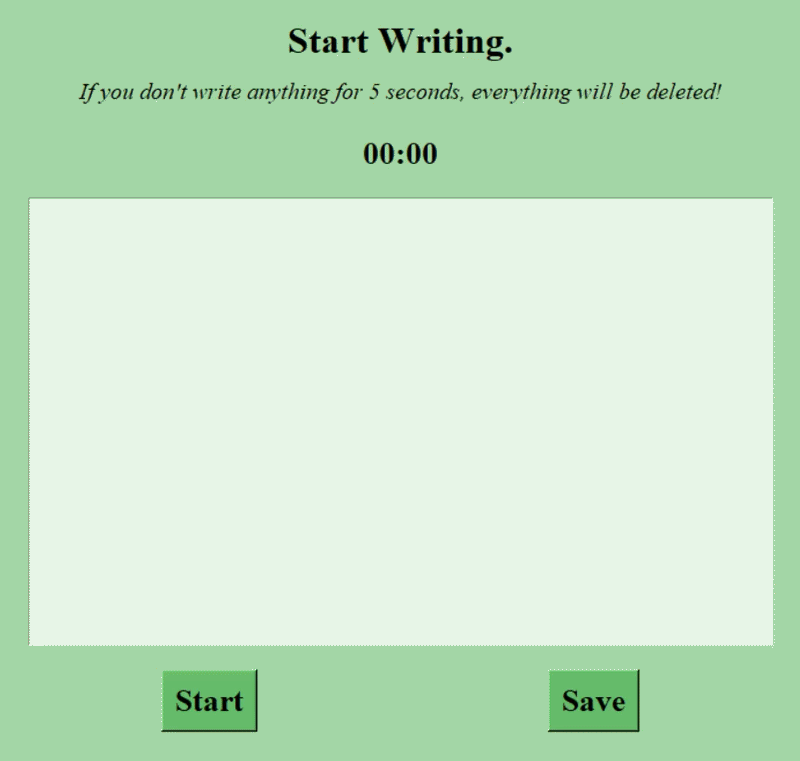

# Writing Block App

**A Python writing application where your work is deleted if you stop writing for 5 seconds.**



## Project Structure
- `main.py` Starts the application.

## Features
- A 5-second timer that resets whenever you type.
- Deletes all text if you stop typing for 5 seconds.
- Save your writing as a `.txt` file.
- Continue writing after saving.
- Displays the elapsed writing time.

## Technologies
- Python 3
- Tkinter (GUI)

## Concepts Practiced
- Object-Oriented Programming (OOP)
- Tkinter GUI Development
- Event Binding
- Timers with `after()`
- File Dialogs
- Writing Text Files
- Updating the GUI dynamically

## How to Run
```bash
python main.py
```